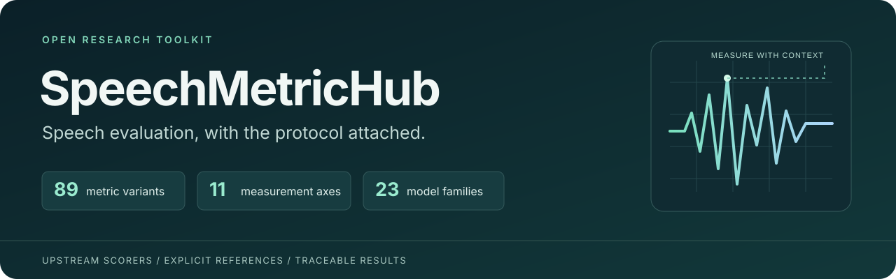

<p align="center"></p>

<p align="center">
  <a href="https://github.com/YangXu212/SpeechMetricHub/actions/workflows/ci.yml"></a>
  <a href="https://github.com/YangXu212/SpeechMetricHub/releases"></a>
  <a href="LICENSE"></a>
  
</p>

<p align="center"><b>English</b> · <a href="README.zh-CN.md">简体中文</a> · <a href="docs/README.md">Documentation</a> · <a href="docs/METRICS.md">Metric catalog</a> · <a href="validation/README.md">Validation evidence</a></p>

**SpeechMetricHub** brings established speech scorers and pretrained evaluation models behind one Python and command-line interface. It makes reference requirements, preprocessing, model identities, score directions and aggregation rules visible alongside the result.

Use it for transcription, diarization, speech quality, intelligibility, signal fidelity and similarity research. Select metrics by **what they measure**, then filter by reference conditions and task tags.

> **89 canonical metric variants · 11 measurement dimensions · 23 model families.**
> Variants and output heads are counted separately; five compatibility aliases are excluded. These are integrations and explicit evaluation profiles, not 89 newly proposed algorithms.

## Why use it?

- **Keep the full output.** Audiobox CE/CU/PC/PQ; all four SCOREQ domain/mode combinations; all five NISQA dimensions; calibrated and raw DNSMOS outputs; SpeechBERTScore precision/recall/F1.
- **Compare under an explicit protocol.** Fix text normalization, speaker assignment, timing collars, UEM, resampling, model artifacts and reference selection.
- **Keep failures visible.** Missing dependencies, invalid inputs and incomplete batches do not silently become zero scores or disappear from an average.
- **Reuse upstream implementations.** MeetEval, pyannote.metrics, fast-bss-eval and the original model projects provide the scoring algorithms.
- **Inspect the evidence.** The repository includes a per-interface validation matrix, model/source fingerprints and repeatable checks. Real model execution is distinguished from ordinary CI.

## New in v0.7

**V/UV F1 and F0 RMSE** now have five explicit interfaces: synchronized WORLD reconstruction, Amphion raw-Hz/voicing recipes and ESPnet log-F0 RMSE. Same-family calls share feature extraction; results include voicing counts and coverage. See [protocols, caveats and usage](docs/PITCH.md) and [real-audio upstream validation](validation/pitch-v0.7.json). Install with `pip install ".[pitch]"`. Existing metrics retain their definitions and earlier validation evidence.

## Added in v0.6

A pinned [full environment](requirements.txt), a [shared cluster deployment guide](docs/SHARED_DEPLOYMENT.md), and `MetricHub` provide one verified entry point for the complete registry. Every ID is called independently in the [single-environment acceptance report](validation/shared-environment-v0.6.json). The profile retains Torch 2.8/CUDA 12.8 and uses CPU ONNX Runtime 1.16.3; model artifacts are provisioned separately. Existing metric definitions are unchanged.

## Added in v0.5

**AECMOS ECHO/DEG** across three explicit model profiles, **ERLE** with far-end-only energy pooling, and dataset-level **EER/minDCF**. Deployments can now lock and verify artifacts, code and dependency versions before scoring. See [exact conventions](docs/AEC_VERIFICATION.md), [deployment guide](docs/DEPLOYMENT_LOCKS.md), and [validation evidence](validation/aec-verification-v0.5.json). AECMOS uses a tested compatibility pin rather than modifying the upstream model.

## Added in v0.4

The [research and integration plan](docs/EXPANSION_PLAN.md) led to 11 additional interfaces: multilingual mHuBERT SBS **P/R/F1**, phone-token **LPS**, **WavLM speaker cosine**, **PLCMOS v2/final and validation**, and four explicitly named **LSD/MCD profiles**. Existing IDs retain their semantics.

See [profile definitions and examples](docs/EXPANSION_PROFILES.md) and the [release validation evidence](validation/expansion-v0.4.json). In particular, IPA-character LPS is different from phone-token LPS, and natural-log gain-fitted LSD is different from dB LSD.

## Quick start

### Install from this repository

Python 3.10 or 3.11 is recommended. Start in a dedicated environment. MeetEval and PESQ may require a C/C++ compiler; on Debian/Ubuntu install `build-essential` first.

```bash
git clone https://github.com/YangXu212/SpeechMetricHub.git
cd SpeechMetricHub
python -m venv .venv
source .venv/bin/activate  # Windows: .venv\Scripts\Activate.ps1
python -m pip install --upgrade pip
python -m pip install ".[transcription]"
```

For transcription, waveform and diarization scorers together:

```bash
python -m pip install "numpy<2" ".[transcription,quality,separation,diarization]"
```

Installable wheels and source archives are provided in [GitHub Releases](https://github.com/YangXu212/SpeechMetricHub/releases). **This project is not currently published to PyPI.** Heavy model environments are optional; see [installation](docs/INSTALLATION.md).

### Score a transcript

```python
from speechmetrichub import run

result = run("wer", reference="hello world", hypothesis="hello word")
print(result["value"])  # 50.0 — percent
print(result["N"], result["S"], result["D"], result["I"])  # 2 1 0 0
```

### Score speaker-attributed transcription

```python
reference = [{"speaker": "A", "start": 0.0, "end": 2.0, "text": "hello world"}]
hypothesis = [{"speaker": "speaker_0", "start": 0.1, "end": 2.1, "text": "hello word"}]

cp = run("cpwer", reference=reference, hypothesis=hypothesis)
tcp = run("tcpwer", reference=reference, hypothesis=hypothesis, collar=5.0)
```

One call is one recording. Speaker permutation is recording-wide. TS-ASR requires the predetermined target stream; it must not select the best hypothesis speaker using the answer.

### Discover and use the CLI

```bash
speechmetrichub list --category perceptual_quality
speechmetrichub list --task tse --reference-kind none
speechmetrichub run tcpwer --input examples/tcpwer.json --output result.json
speechmetrichub batch ts_wer --input examples/batch_ts_asr.json --output report.json
speechmetrichub doctor
```

`python -m speechmetrichub` is equivalent. The legacy `speech_eval` Python namespace and `speech-eval` command remain supported.

## What can you measure?

| Measurement dimension | Included metrics / output variants |
|---|---|
| Recognition | WER/CER, TS-WER/CER, cpWER/cpCER, tcpWER/tcpCER, ORC/tcORC, MIMO/tcMIMO, greedy DI-cp/DI-tcp, Whisper WER/dWER |
| Speaker structure | DER, JER, speaker-count error and diagnostics |
| Speech activity | Detection error, precision, recall, accuracy |
| Perceptual quality | PESQ WB/NB, ViSQOL speech/audio, DNSMOS calibrated/raw heads and P.808 head, NISQA five dimensions, SCOREQ four modes, UTMOS22 strong, SHEET SSL-MOS; PLCMOS v2/final and validation; AECMOS ECHO/DEG (three profiles) |
| Intelligibility | STOI, ESTOI |
| Signal fidelity | SI-SDR, SI-SDR improvement, BSS SDR/SIR/SAR; LSD and DTW MCD profiles |
| Speaker identity | RawNet3 and WavLM-base-plus-SV embedding cosine; trial-level EER/minDCF |
| Echo attenuation | ERLE with explicit far-end-only regions and energy pooling |
| Content similarity | IPA character similarity; HuBERT/mHuBERT SpeechBERTScore precision, recall, F1; character/phone LPS |
| Audio aesthetics | Audiobox Content Enjoyment, Content Usefulness, Production Complexity, Production Quality |
| Rating agreement | Pearson, Spearman, Kendall tau-b |

The [metric catalog](docs/METRICS.md) lists every callable ID, reference requirement, unit, direction, configuration and limitation. Enhancement, TSE, codec, synthesis and conversion are **task tags**, not the primary taxonomy. This taxonomy is an engineering organization, not a claim of endorsement by a standards body.

## Pretrained models: explicit configuration

Models run in separate processes, using explicitly supplied local artifacts. Discovery does not load a model. Default execution is CPU with two threads; the validated model environment is Linux / Python 3.10 / CPU.

```python
from speechmetrichub import evaluate

scores = evaluate(
    ["audiobox_aesthetics_ce", "audiobox_aesthetics_cu",
     "audiobox_aesthetics_pc", "audiobox_aesthetics_pq"],
    hypothesis="/audio/example.wav",
    configs={"audiobox_aesthetics": {
        "checkpoint": "/models/audiobox/checkpoint.pt",
        "trusted_checkpoint": True,
        "device": "cpu",
        "threads": 2,
    }},
)
```

All requested heads of the same family share a forward pass within this call. Each recording starts a fresh worker; persistent high-throughput serving is not implemented.

Use [configuration templates](examples/deployment.example.json), the [model setup guide](docs/MODELS.md), and `doctor --config deployment.local.json --verify-hashes`. Model weights and upstream executables are not redistributed.

**Direction matters:** SCOREQ NR predicts MOS (higher is better); SCOREQ REF is an embedding distance (lower is better). Audiobox PC describes production complexity and is not a quality ranking. Whisper dWER measures agreement with an ASR transcript of clean audio, not ground-truth WER.

## Reproducibility and validation

The inherited v0.2 integration baseline contains actual executions for **all 69 registered IDs**: 64 canonical variants and five aliases. It records 64 model invalid-input cases, eight independent model-family comparisons against upstream calls, and six identity-property checks. See the [evidence matrix](validation/summary.json) and [scope of these claims](validation/README.md).

The public v0.3 release adds packaging, a stable public import facade, documentation and release checks. CI tests standard scorers and the public API on Linux/Python 3.10 and 3.11. Heavy pretrained-model tests use separately provisioned local artifacts and are **not** represented as public CI coverage.

```bash
python -m pip install "numpy<2" ".[transcription,quality,separation,diarization,dev]"
python -m unittest discover -s tests -v
python scripts/check_docs.py
python -m build
```

Important protocol boundaries:

- WER-like corpus scores accumulate errors and reference units. DER/VAD accumulate time components; JER accumulates speaker errors. Quality scores use utterance macro averaging.
- Incomplete batches have no complete-set score; the valid-subset score and coverage are separate.
- Sentence-interpolated tcpWER is not equivalent to evaluation with manually verified word timestamps. Collar values are profile choices.
- DER/JER require genuine speech-activity annotations and an explicit UEM. Transcript sentence spans are not automatically suitable reference activity.
- Interface correctness does not establish validity on every language, distortion type or task, and does not reproduce a complete benchmark leaderboard.

## Documentation

| Start here | Research and deployment |
|---|---|
| [Installation](docs/INSTALLATION.md) | [Evaluation protocols](docs/PROTOCOLS.md) |
| [Python and CLI API](docs/API.md) | [Model setup and artifacts](docs/MODELS.md) |
| [Metric catalog](docs/METRICS.md) | [Validation evidence](validation/README.md) |
| [Runnable examples](examples/README.md) | [Architecture and extensions](docs/EXTENDING.md) |
| [Troubleshooting](docs/TROUBLESHOOTING.md) | [Roadmap](docs/ROADMAP.md) |

## Contributing, citation and licensing

Contributions should preserve upstream outputs and include real runtime evidence for new model integrations. See [CONTRIBUTING.md](CONTRIBUTING.md) and the metric-request issue template.

If this toolkit supports your research, cite this software using [CITATION.cff](CITATION.cff), and cite the original methods actually used. SpeechMetricHub is an integration toolkit, not the author of the underlying metrics.

Integration code is [MIT licensed](LICENSE). Upstream implementations, models and datasets retain their own licenses; see [THIRD_PARTY.md](THIRD_PARTY.md). [Security and trust boundaries](SECURITY.md) describe local checkpoint and source-code execution.
