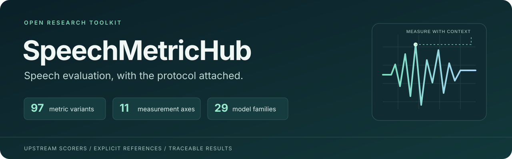

<p align="center"></p>

<p align="center">
  <a href="https://github.com/YangXu212/SpeechMetricHub/actions/workflows/ci.yml"></a>
  <a href="https://github.com/YangXu212/SpeechMetricHub/releases"></a>
  <a href="LICENSE"></a>
  
</p>

<p align="center"><b>English</b> · <a href="README.zh-CN.md">简体中文</a> · <a href="docs/README.md">Documentation</a> · <a href="docs/METRICS.md">Metric catalog</a> · <a href="validation/README.md">Validation evidence</a> · <a href="CHANGELOG.md">Changelog</a></p>

**SpeechMetricHub** brings established speech scorers and pretrained evaluation models behind one Python and command-line interface. It makes reference requirements, preprocessing, model identities, score directions, and aggregation rules explicit alongside every result.

Use it for transcription, diarization, speech quality, intelligibility, signal fidelity, pitch/voicing, echo cancellation, and speaker/content similarity research. Select metrics by **what they measure**, then filter by reference conditions and task tags.

> **102 canonical metric variants · 11 measurement dimensions · 34 model families.**
> Variants and output heads are counted separately; five compatibility aliases are excluded. These are integrations and explicit evaluation profiles, not newly proposed algorithms.

## Why SpeechMetricHub?

- **Complete outputs, explicit directions.** Audiobox CE/CU/PC/PQ; all four SCOREQ domain/mode combinations; all five NISQA dimensions; calibrated and raw DNSMOS heads; SpeechBERTScore precision/recall/F1; AECMOS ECHO/DEG across three profiles.
- **Reproducible, locked protocols.** Fix text normalization, speaker assignment, timing collars, UEM, resampling, model artifacts, dependency versions, and reference selection via deployment locks and `MetricHub`.
- **Visible failures and fair corpus accounting.** Missing dependencies, invalid inputs, truncated decodes, and incomplete batches never silently become zero scores or disappear from an average. `compare_recognition` reports full expected support alongside conditional common subsets.
- **Upstream implementations preserved.** MeetEval, pyannote.metrics, fast-bss-eval, OpenAI Whisper, Hugging Face Transformers, ESPnet, S3PRL, PyWorld, Praat/Parselmouth, and the original neural model projects provide the scoring algorithms.
- **Inspectable validation evidence.** The repository ships versioned per-interface runtime reports, model/source fingerprints, and repeatable parity harnesses—clearly separating lightweight CI from real pretrained-model validation.

## Measurement dimensions

| Measurement dimension | Included metrics / output variants |
|---|---|
| Recognition | WER/CER, TS-WER/CER, cpWER/cpCER, tcpWER/tcpCER, ORC/tcORC, MIMO/tcMIMO, greedy DI-cp/DI-tcp; OpenAI Whisper WER/dWER (`whisper_wer_en_openai`, `whisper_dwer_en_openai`), upgraded HF Whisper v3 (`whisper_wer_hf_v3`, `whisper_dwer_hf_v3`), legacy Whisper WER/dWER; Cohere Transcribe WER/CER/dWER/dCER and explicit English/Mandarin profiles |
| Speaker structure | DER, JER, speaker-count error and diagnostics |
| Speech activity | Detection error, precision, recall, accuracy |
| Perceptual quality | PESQ WB/NB, ViSQOL speech/audio, DNSMOS calibrated/raw heads and P.808 head, NISQA five dimensions, SCOREQ four modes, UTMOS22 strong, SHEET SSL-MOS, PLCMOS v2/final and validation, AECMOS ECHO/DEG (16k/48k/scenarioless) |
| Intelligibility | STOI, ESTOI |
| Signal fidelity | SI-SDR, SI-SDR improvement, BSS SDR/SIR/SAR; explicit LSD and DTW MCD profiles; V/UV F1 and F0 RMSE (WORLD, Amphion, ESPnet log-F0) |
| Speaker identity | RawNet3, WavLM-base-plus-SV, and UniSpeech WavLM-Large-ECAPA embedding cosine; dataset-level EER and minDCF |
| Echo attenuation | ERLE with explicit far-end-only regions and energy pooling |
| Content similarity | IPA character similarity; HuBERT/mHuBERT SpeechBERTScore precision, recall, F1; character and phone-token LPS |
| Audio aesthetics | Audiobox Content Enjoyment, Content Usefulness, Production Complexity, Production Quality |
| Rating agreement | Pearson, Spearman, Kendall tau-b |

The [metric catalog](docs/METRICS.md) documents every callable ID, reference requirement, unit, direction, configuration, and limitation. Enhancement, TSE, codec, synthesis, and conversion are **task tags**, not the primary taxonomy.

## Quick start

### Installation

Python 3.10 or 3.11 is recommended. Start in a dedicated environment. MeetEval and PESQ may require a C/C++ compiler; on Debian/Ubuntu install `build-essential` first.

```bash
git clone https://github.com/YangXu212/SpeechMetricHub.git
cd SpeechMetricHub
python -m venv .venv
source .venv/bin/activate  # Windows: .venv\Scripts\Activate.ps1
python -m pip install --upgrade pip
python -m pip install ".[transcription]"
```

For transcription, waveform, spectral, pitch, and diarization scorers together:

```bash
python -m pip install "numpy<2" ".[transcription,quality,separation,diarization,spectral,pitch]"
```

Installable wheels and source archives are provided in [GitHub Releases](https://github.com/YangXu212/SpeechMetricHub/releases) (**not currently published to PyPI**). For pinned full environments, optional neural workers, and shared cluster installations, see [Installation](docs/INSTALLATION.md) and [Shared deployment](docs/SHARED_DEPLOYMENT.md).

### Score transcripts and speaker-attributed ASR

```python
from speechmetrichub import run

result = run("wer", reference="hello world", hypothesis="hello word")
print(result["value"])  # 50.0 — percent
print(result["N"], result["S"], result["D"], result["I"])  # 2 1 0 0

reference = [{"speaker": "A", "start": 0.0, "end": 2.0, "text": "hello world"}]
hypothesis = [{"speaker": "speaker_0", "start": 0.1, "end": 2.1, "text": "hello word"}]

cp = run("cpwer", reference=reference, hypothesis=hypothesis)
tcp = run("tcpwer", reference=reference, hypothesis=hypothesis, collar=5.0)
```

One call is one recording. Speaker permutation is recording-wide. TS-ASR requires the predetermined target stream and never selects the best hypothesis speaker using the reference.

### Compare ASR systems across a frozen corpus

```python
from speechmetrichub import compare_recognition

report = compare_recognition(
    {"system_a": rows_a, "system_b": rows_b},
    expected_ids=expected_utterance_ids,
)
print(report["full_corpus_comparable"], report["common_subset"]["coverage"])
```

### CLI

```bash
speechmetrichub list --category perceptual_quality
speechmetrichub list --task tse --reference-kind none
speechmetrichub run tcpwer --input examples/tcpwer.json --output result.json
speechmetrichub batch ts_wer --input examples/batch_ts_asr.json --output report.json
speechmetrichub doctor
```

`python -m speechmetrichub` is equivalent. The legacy `speech_eval` Python namespace and `speech-eval` command remain supported.

## Pretrained models and locked deployments

Pretrained models execute in isolated subprocesses using explicitly supplied local artifacts—no weights are downloaded during scoring, and discovery/`doctor` never load models. Default execution is CPU with two threads; explicit `cuda:N` devices are supported where configured.

```python
from speechmetrichub import evaluate

scores = evaluate(
    ["audiobox_aesthetics_ce", "audiobox_aesthetics_cu",
     "audiobox_aesthetics_pc", "audiobox_aesthetics_pq"],
    hypothesis="/audio/example.wav",
    configs={"audiobox_aesthetics": {
        "checkpoint": "/models/audiobox/checkpoint.pt",
        "trusted_checkpoint": True,
        "device": "cpu",
        "threads": 2,
    }},
)
```

All requested heads of the same family share one forward pass within an `evaluate()` call. For shared lab clusters, lock code, dependency versions, and artifact SHA-256 hashes with `create_deployment` / `MetricHub`:

```python
from speechmetrichub import MetricHub

hub = MetricHub("/path/to/deployment.locked.json")
res = hub.run("whisper_wer_en_openai", reference="hello world", hypothesis="enh.wav")
```

**Protocol tips:**

- **Whisper & Cohere ASR:** For speech enhancement / TSE paper reproduction, prefer `whisper_wer_en_openai` / `whisper_dwer_en_openai` (exact OpenAI Whisper pipeline; see [Whisper ASR profiles](docs/WHISPER_ASR.md)) or `cohere_wer_en_whisper` / `cohere_dwer_en_whisper` (see [Cohere profiles](docs/COHERE_PROFILES.md)). Legacy `whisper_wer` / `whisper_dwer` are preserved for historical lock compatibility.
- **Speaker identity:** Choose explicitly among `speaker_similarity` (RawNet3), `speaker_similarity_wavlm` (WavLM-base-plus-SV), and `speaker_similarity_unispeech_wavlm` (UniSpeech WavLM-Large-ECAPA).
- **Direction matters:** SCOREQ NR predicts MOS (higher is better); SCOREQ REF is an embedding distance (lower is better). Audiobox PC is descriptive production complexity, not a quality ranking. `*_dwer` / `*_dcer` measure agreement with clean-reference ASR, not ground-truth WER/CER.

Use [deployment.example.json](examples/deployment.example.json), [Model setup](docs/MODELS.md), and `speechmetrichub doctor --config deployment.local.json --verify-hashes`. Model weights and upstream executables are not redistributed.

## Reproducibility and validation

CI verifies standard scorers, public API contracts, deployment-lock semantics, documentation links, and wheel packaging on Linux/Python 3.10 and 3.11. Pretrained-model parity tests require separately provisioned local artifacts and are recorded in versioned reports under [validation/](validation/README.md).

```bash
python -m pip install "numpy<2" ".[transcription,quality,separation,diarization,spectral,verification,echo,pitch,dev]"
python -m ruff check speech_eval speechmetrichub tests scripts
python -m unittest discover -s tests -v
python scripts/check_docs.py
python -m build
```

Core aggregation and protocol boundaries:

- WER/CER/Whisper/Cohere corpus scores pool errors and reference units (`micro`); DER/VAD pool time components; JER pools speaker errors; V/UV F1 and F0 RMSE pool sufficient statistics; ERLE pools far-end-only energy; waveform quality metrics use utterance macro averaging.
- Incomplete batches return `value=None` for the full corpus while reporting `valid_subset_value` and `coverage` separately.
- DER/JER require genuine speech-activity annotations and an explicit UEM; sentence-interpolated tcpWER is not equivalent to manually verified word timestamps.

## Documentation

| Getting started & API | Protocol guides | Deployment & maintenance |
|---|---|---|
| [Installation](docs/INSTALLATION.md) | [Evaluation protocols](docs/PROTOCOLS.md) | [Model setup & artifacts](docs/MODELS.md) |
| [Python & CLI API](docs/API.md) | [Whisper ASR profiles](docs/WHISPER_ASR.md) | [Shared deployment](docs/SHARED_DEPLOYMENT.md) |
| [Metric catalog](docs/METRICS.md) | [Cohere ASR](docs/COHERE_ASR.md) & [Profiles](docs/COHERE_PROFILES.md) | [Deployment locks](docs/DEPLOYMENT_LOCKS.md) |
| [Runnable examples](examples/README.md) | [Pitch & voicing](docs/PITCH.md) | [Validation evidence](validation/README.md) |
| [Troubleshooting](docs/TROUBLESHOOTING.md) | [AEC & verification](docs/AEC_VERIFICATION.md) | [Extending](docs/EXTENDING.md) · [Roadmap](docs/ROADMAP.md) |
| [Changelog](CHANGELOG.md) | [Spectral & expansion profiles](docs/EXPANSION_PROFILES.md) | [Windows build](WINDOWS_BUILD.md) |

## Contributing, citation and licensing

Contributions should preserve upstream outputs and include real runtime evidence for new model integrations. See [CONTRIBUTING.md](CONTRIBUTING.md).

If this toolkit supports your research, cite this software using [CITATION.cff](CITATION.cff) alongside the original methods you evaluate. SpeechMetricHub is an integration toolkit, not the author of the underlying metrics.

Integration code is [MIT licensed](LICENSE). Upstream implementations, models, and datasets retain their own licenses; see [THIRD_PARTY.md](THIRD_PARTY.md). [SECURITY.md](SECURITY.md) documents local checkpoint and source-code trust boundaries.
