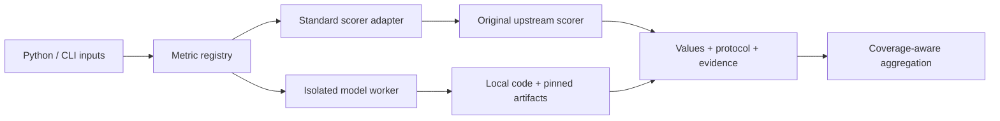

# Architecture and extensions

| Module | Responsibility |
|---|---|
| `speechmetrichub` | Public API facade; identical function objects to the legacy namespace |
| `speech_eval/registry.py` and `metrics.json` | Discovery, metadata, lazy dispatch and custom registrations |
| `transcription.py` | Normalization, MeetEval adaptation and workbench-compatible alignments |
| `audio.py`, `diarization.py`, `standard.py` | Standard waveform/activity/multistream/rating adapters |
| `models.py`, `model_worker.py` | Family sharing, process execution, upstream inference and provenance |
| `batch.py`, `aggregate.py` | General corpus summaries and historical workbench summaries |
| `doctor.py` | Dependency and local-artifact inspection without inference |
| `external.py` | Optional legacy process/SCP bridge, not the implementation of the native model catalog |

An integration should keep adaptation code small and delegate scoring to the original implementation. An interface wrapper is not evidence that its backend actually runs.

## Adding a metric

1. Identify the primary implementation, license, model variants and every relevant output head.
2. Define measurement category, reference conditions, task tags, score direction and units.
3. Specify input validity, preprocessing, reference selection, empty/silent behavior, assignment/alignment and aggregation.
4. Add a lazy adapter and registry entry. For multi-head models, reuse a family and select distinct outputs.
5. Compare a real invocation against upstream or a well-defined analytic property. Cover incorrect inputs and failure reporting.
6. Save dependency/source versions, artifact/input hashes, numerical tolerance and scope. Distinguish an unvalidated candidate from a validated interface.
7. Update the catalog, configuration examples, tests and validation report. A protocol-changing update requires an explicit profile/version change.

Do not include private deployment paths, model weights or recordings in a contribution. Model workers isolate dependencies and resource settings; they are not a hostile-code sandbox.
